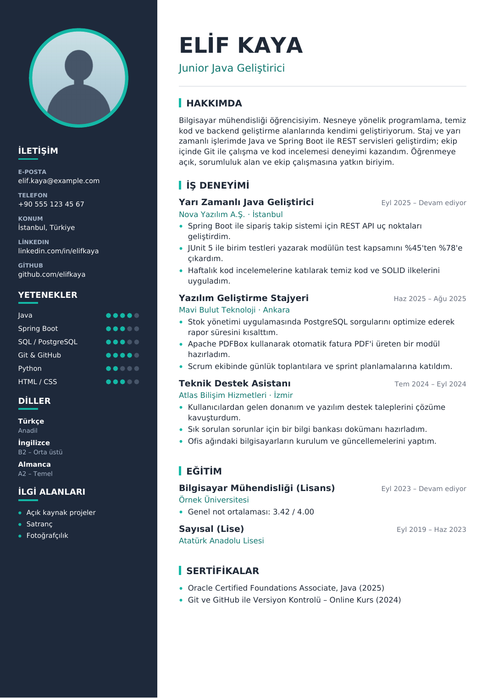
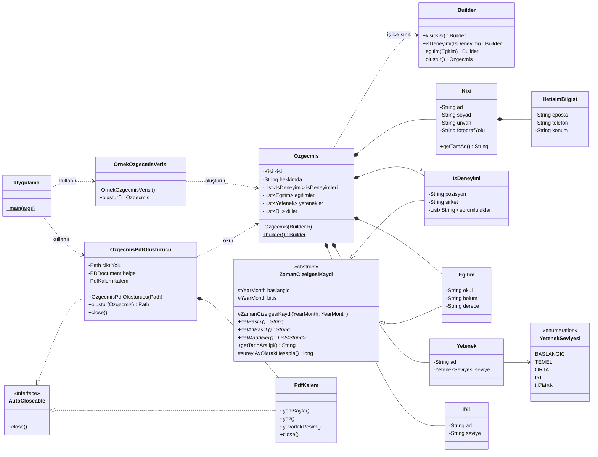

# Özgeçmiş PDF Oluşturucu


Nesneye yönelik programlama (OOP) ilkeleri kullanılarak geliştirilmiş, **fotoğraflı ve iki sütunlu bir özgeçmişi PDF olarak üreten** Java konsol uygulaması.

Proje; sınıf tasarımı, kapsülleme, kalıtım, çok biçimlilik, nesne yaşam döngüsü ve erişim belirleyicilerinin gerçek bir uygulama içinde nasıl kullanıldığını göstermek amacıyla hazırlanmıştır.

<p align="center">
  
</p>

> Örnek çıktının kendisi: [`docs/ornek-ozgecmis.pdf`](docs/ornek-ozgecmis.pdf)
> Özgeçmişteki kişisel bilgiler ve iş deneyimleri **hayalidir**.

---

## İçindekiler

- [Özellikler](#özellikler)
- [Kurulum ve Çalıştırma](#kurulum-ve-çalıştırma)
- [Kendi Bilgilerinizle Kullanma](#kendi-bilgilerinizle-kullanma)
- [Proje Yapısı](#proje-yapısı)
- [Sınıf Diyagramı](#sınıf-diyagramı)
- [Kullanılan Sınıflar ve Nesneler](#kullanılan-sınıflar-ve-nesneler)
- [Nesne Yaşam Döngüsü](#nesne-yaşam-döngüsü)
- [Erişim Belirleyiciler](#erişim-belirleyiciler)
- [Kullanılan OOP Kavramları ve Tasarım Desenleri](#kullanılan-oop-kavramları-ve-tasarım-desenleri)
- [Kullanılan Teknolojiler](#kullanılan-teknolojiler)
- [Yapay Zekâ Araçlarının Kullanımı](#yapay-zekâ-araçlarının-kullanımı)

---

## Özellikler

- Tek komutla **A4 boyutunda PDF özgeçmiş** üretimi
- Daire şeklinde kırpılmış **profil fotoğrafı**
- **Üç iş deneyimi**, eğitim, yetenekler (1–5 seviye göstergesi), diller, sertifikalar ve ilgi alanları
- Türkçe karakterlerin (ç, ğ, ı, İ, ö, ş, ü) eksiksiz görüntülenmesi için gömülü yazı tipi
- Uzun metinlerin otomatik satır kaydırması, içerik sığmazsa **otomatik yeni sayfa**
- PDF oluşturma işlemi `main` içinde değil, ayrı bir sınıfta (`OzgecmisPdfOlusturucu`)
- Veri, model ve PDF katmanları birbirinden ayrı; kendi bilgilerinizi girmek için **tek bir dosyayı** düzenlemeniz yeterli

## Kurulum ve Çalıştırma

### Gereksinimler

| Araç | Sürüm |
|---|---|
| JDK | 17 veya üzeri (geliştirme JDK 21 ile yapıldı) |
| Maven | 3.6+ (IntelliJ IDEA ile birlikte gelir, ayrıca kurmanız gerekmez) |

### IntelliJ IDEA ile (önerilen)

1. Depoyu klonlayın veya ZIP olarak indirip açın:
   ```bash
   git clone https://github.com/betulyldrmm/ozgecmis-pdf-olusturucu.git
   ```
2. IntelliJ IDEA'da **File → Open** ile proje klasörünü seçin. `pom.xml` dosyası algılanır ve PDFBox kütüphanesi otomatik indirilir.
3. `src/main/java/com/ozgecmis/Uygulama.java` dosyasını açıp `main` metodunun yanındaki yeşil ▶ simgesine tıklayın (veya `Shift + F10`).
4. PDF, proje klasöründe `cikti/ozgecmis.pdf` olarak oluşturulur.

### Komut satırı ile

```bash
# Derle ve çalıştır
mvn compile exec:java

# Ya da tüm bağımlılıkları içeren çalıştırılabilir JAR üret
mvn package
java -jar target/ozgecmis-pdf-olusturucu-1.0.0-jar-with-dependencies.jar

# Farklı bir çıktı yolu vermek için
java -jar target/ozgecmis-pdf-olusturucu-1.0.0-jar-with-dependencies.jar benim-ozgecmisim.pdf
```

Örnek konsol çıktısı:

```text
[1/3] Özgeçmiş verileri hazırlanıyor...
      Kişi        : Elif Kaya (Junior Java Geliştirici)
      İş deneyimi : Yarı Zamanlı Java Geliştirici @ Nova Yazılım A.Ş. (Eyl 2025 – Devam ediyor)
      İş deneyimi : Yazılım Geliştirme Stajyeri @ Mavi Bulut Teknoloji (Haz 2025 – Ağu 2025)
      İş deneyimi : Teknik Destek Asistanı @ Atlas Bilişim Hizmetleri (Tem 2024 – Eyl 2024)
[2/3] PDF oluşturuluyor...
[3/3] Tamamlandı: .../cikti/ozgecmis.pdf (1 sayfa)
```

## Kendi Bilgilerinizle Kullanma

| Ne değiştirilecek? | Nerede? |
|---|---|
| Ad, iletişim, deneyimler, eğitim, yetenekler | `src/main/java/com/ozgecmis/veri/OrnekOzgecmisVerisi.java` |
| Profil fotoğrafı | `src/main/resources/foto/profil.jpg` dosyasını kendi fotoğrafınızla değiştirin (JPG veya PNG) |
| Renkler, kenar boşlukları, yazı boyutları | `src/main/java/com/ozgecmis/pdf/Tema.java` |

Fotoğraf kare olmak zorunda değildir; uygulama ortasından kare olarak kırpar ve daire şeklinde yerleştirir.

## Proje Yapısı

```text
ozgecmis-pdf-olusturucu/
├── pom.xml                                  # Maven yapılandırması ve bağımlılıklar
├── docs/
│   ├── onizleme.png                         # README önizleme görseli
│   └── ornek-ozgecmis.pdf                   # Örnek çıktı
└── src/main/
    ├── java/com/ozgecmis/
    │   ├── Uygulama.java                    # main metodu (giriş noktası)
    │   ├── model/                           # Özgeçmişi temsil eden veri sınıfları
    │   │   ├── Ozgecmis.java                #   ana model + Builder
    │   │   ├── Kisi.java
    │   │   ├── IletisimBilgisi.java
    │   │   ├── ZamanCizelgesiKaydi.java     #   soyut üst sınıf
    │   │   ├── IsDeneyimi.java              #   ZamanCizelgesiKaydi'ndan türer
    │   │   ├── Egitim.java                  #   ZamanCizelgesiKaydi'ndan türer
    │   │   ├── Yetenek.java
    │   │   ├── YetenekSeviyesi.java         #   enum
    │   │   ├── Dil.java
    │   │   └── Dogrula.java                 #   paket içi doğrulama yardımcısı
    │   ├── veri/
    │   │   └── OrnekOzgecmisVerisi.java     # Hayali özgeçmiş verisi
    │   └── pdf/
    │       ├── OzgecmisPdfOlusturucu.java   # PDF'i oluşturan sınıf
    │       ├── PdfKalem.java                # Düşük seviyeli çizim yardımcısı
    │       └── Tema.java                    # Renk ve ölçü sabitleri
    └── resources/
        ├── fonts/                           # DejaVu Sans (Türkçe karakter desteği)
        └── foto/profil.jpg                  # Profil fotoğrafı
```

Katmanlar arasındaki bağımlılık tek yönlüdür:

```text
Uygulama ──► veri ──► model ◄── pdf
```

`model` paketi hiçbir paketi bilmez; `pdf` paketi yalnızca modeli okur. Bu sayede örneğin PDF yerine HTML çıktı üreten yeni bir sınıf eklenmek istense model sınıflarına dokunmak gerekmez.

## Sınıf Diyagramı



> Gösterim: `-` private, `#` protected, `~` package-private (default), `+` public, `$` static, `*` abstract.

## Kullanılan Sınıflar ve Nesneler

| Sınıf | Paket | Görevi | Neden bu şekilde tasarlandı? |
|---|---|---|---|
| `Uygulama` | `com.ozgecmis` | Programın giriş noktası (`main`) | `main` yalnızca akışı yönetir; PDF işini kendisi yapmaz, ilgili nesneye devreder. |
| `Ozgecmis` | `model` | Özgeçmişin tamamını bir arada tutar | Çok sayıda alanı olduğu için **Builder** ile adım adım oluşturulur; yapıcısı `private` olduğundan hatalı/eksik nesne oluşturulamaz. |
| `Ozgecmis.Builder` | `model` | `Ozgecmis` nesnesini kurar | Zincirleme çağrılarla okunaklı veri girişi sağlar ve `olustur()` sırasında doğrulama yapar. |
| `Kisi` | `model` | Ad, soyad, unvan, fotoğraf yolu | Kişisel bilgileri tek bir nesnede toplar; `IletisimBilgisi`'ni **bileşim** ile içerir. |
| `IletisimBilgisi` | `model` | E-posta, telefon, konum, LinkedIn, GitHub | İletişim alanlarını `Kisi`'den ayırarak sınıfları küçük ve odaklı tutar. **Aşırı yüklenmiş yapıcı** içerir. |
| `ZamanCizelgesiKaydi` | `model` | Tarih aralığı olan kayıtların **soyut** üst sınıfı | İş deneyimi ve eğitimin ortak alanlarını (başlangıç, bitiş) ve davranışlarını (tarih biçimlendirme) tek yerde toplar; kod tekrarını önler. |
| `IsDeneyimi` | `model` | Pozisyon, şirket, şehir, sorumluluklar | `ZamanCizelgesiKaydi`'ndan **kalıtım** alır, soyut metotları kendine göre doldurur. |
| `Egitim` | `model` | Okul, bölüm, derece, not ortalaması | Aynı üst sınıftan türediği için PDF tarafında `IsDeneyimi` ile aynı kodla çizilir. |
| `Yetenek` | `model` | Yetenek adı ve seviyesi | Ad ile seviyeyi birbirine bağlı tutar. |
| `YetenekSeviyesi` | `model` | 1–5 arası seviye sabitleri (`enum`) | Seviyenin geçersiz bir değer almasını derleme anında engeller. |
| `Dil` | `model` | Dil adı ve seviyesi | Yabancı dil bilgisini ayrı bir kavram olarak modeller. |
| `Dogrula` | `model` | Boş/null kontrolleri | Tüm model sınıflarında aynı doğrulama kodunu tekrar yazmamak için. Yalnızca paket içinde kullanıldığından **package-private**. |
| `OrnekOzgecmisVerisi` | `veri` | Hayali özgeçmiş verisini üretir | Veriyi koddan ayırır; kendi bilgilerinizi girmek için yalnızca bu dosya değişir. |
| `OzgecmisPdfOlusturucu` | `pdf` | `Ozgecmis` nesnesini PDF'e dönüştürür | Ödevin şartı gereği PDF işlemi ayrı bir sınıftadır. `AutoCloseable` uygulayarak kaynakları güvenle kapatır. |
| `PdfKalem` | `pdf` | Metin, şekil, yuvarlak fotoğraf çizimi | PDFBox'ın düşük seviyeli komutlarını gizler; "ne çizilecek" ile "nasıl çizilecek" sorumluluklarını ayırır. |
| `Tema` | `pdf` | Renk, ölçü ve yazı boyutu sabitleri | Tasarım değerlerini tek bir yerde toplar; sihirli sayıları (magic numbers) koddan uzaklaştırır. |

### Uygulamada oluşturulan nesneler

`main` çalıştığında bellekte oluşan nesne ağacı:

```text
Ozgecmis
├── Kisi
│   └── IletisimBilgisi
├── IsDeneyimi × 3   (her biri bir List<String> sorumluluk listesi içerir)
├── Egitim × 2
├── Yetenek × 6      (her biri bir YetenekSeviyesi enum sabitine bağlı)
├── Dil × 3
└── String listeleri (sertifikalar, ilgi alanları)

OzgecmisPdfOlusturucu
├── PDDocument       (PDFBox belge nesnesi)
├── PDType0Font × 2  (normal ve kalın yazı tipi)
└── PdfKalem
    └── PDPageContentStream  (her sayfa için yeniden oluşturulur)
```

## Nesne Yaşam Döngüsü

Java'da bir nesnenin hayatı dört aşamadan geçer: **oluşturma → kullanma → erişilemez hâle gelme → çöp toplayıcı tarafından yok edilme**. Projede bu aşamalar şöyle görülür:

### 1. Oluşturma (`new` ve yapıcı metotlar)

```java
Kisi kisi = new Kisi("Elif", "Kaya", "Junior Java Geliştirici", "foto/profil.jpg", iletisim);
```

- `new` ile heap üzerinde yer ayrılır, ardından **yapıcı (constructor)** çalışarak alanlara ilk değerleri verir.
- Yapıcılar aynı zamanda **doğrulama** yapar; örneğin ad boşsa `IllegalArgumentException` fırlatılır ve geçersiz nesne hiç oluşmaz.
- **Yapıcı zincirleme:** `IletisimBilgisi`'nin 3 parametreli yapıcısı `this(...)` ile 5 parametreli yapıcıyı çağırır.
- **Kalıtımda çağrı sırası:** `new IsDeneyimi(...)` yazıldığında önce `super(baslangic, bitis)` ile `ZamanCizelgesiKaydi`'nın yapıcısı, ardından `IsDeneyimi`'nin geri kalanı çalışır.
- **Kontrollü oluşturma:** `Ozgecmis`'in yapıcısı `private`'tır; nesne yalnızca `Ozgecmis.builder()...olustur()` ile oluşturulabilir.

### 2. Kullanma ve değişmezlik (immutability)

- Model sınıflarındaki tüm alanlar `private final`'dır. Nesne bir kez oluşturulduktan sonra durumu değişmez.
- Listeler `List.copyOf(...)` ile kopyalanır (**savunmacı kopya**). Böylece nesneyi oluşturan kod, sonradan kendi listesini değiştirse bile özgeçmiş etkilenmez; `getIsDeneyimleri().add(...)` çağrısı da hata verir.

### 3. Kaynakların kapatılması (`AutoCloseable` ve try-with-resources)

PDF belgesi bellek ve dosya kaynakları tutar. Java'da C++'taki gibi bir yıkıcı (destructor) olmadığı ve `finalize()` metodunun çağrılması garanti edilmediği (Java 9'dan itibaren kullanımdan kaldırılmıştır) için kaynaklar **açıkça** kapatılmalıdır:

```java
try (OzgecmisPdfOlusturucu pdf = new OzgecmisPdfOlusturucu(ciktiYolu)) {
    pdf.olustur(ozgecmis);
}   // ← burada pdf.close() otomatik çağrılır (hata oluşsa bile)
```

- `OzgecmisPdfOlusturucu.close()` → önce `PdfKalem.close()` (sayfa çizim akışı), sonra `PDDocument.close()`.
- `close()` birden fazla çağrılsa da güvenlidir; kapatılmış nesneyle `olustur()` çağrılırsa `IllegalStateException` fırlatılır.
- Yapıcı metot yarıda kalırsa (ör. yazı tipi bulunamazsa) açılmış olan `PDDocument` yapıcının içinde kapatılır; böylece kaynak sızıntısı olmaz.
- Fotoğraf işlenirken kullanılan `Graphics2D` nesnesi de `finally` bloğunda `dispose()` ile serbest bırakılır.

### 4. Yok edilme (Garbage Collector)

`try` bloğu bittiğinde `pdf` değişkeninin kapsamı sona erer. Nesneye başka bir referans kalmadığı için **çöp toplayıcı** onu uygun bir zamanda bellekten temizler. `main` metodu bittiğinde `ozgecmis` ve ona bağlı tüm nesne ağacı da erişilemez hâle gelir.

## Erişim Belirleyiciler

| Belirleyici | Sınıf | Paket | Alt sınıf | Her yer | Projede kullanıldığı yer |
|---|:-:|:-:|:-:|:-:|---|
| `public` | ✅ | ✅ | ✅ | ✅ | Model sınıfları, getter'lar, `OzgecmisPdfOlusturucu.olustur()`, `Ozgecmis.builder()` |
| `protected` | ✅ | ✅ | ✅ | ❌ | `ZamanCizelgesiKaydi`: `baslangic` ve `bitis` alanları, yapıcı metot, `sureyiAyOlarakHesapla()` |
| *(default)* | ✅ | ✅ | ❌* | ❌ | `Dogrula`, `PdfKalem` ve `Tema` sınıflarının tamamı |
| `private` | ✅ | ❌ | ❌ | ❌ | Tüm model alanları, `Ozgecmis` ve `Builder` yapıcıları, yardımcı sınıfların yapıcıları, PDF çizim yardımcı metotları |

\* Aynı paketteki alt sınıflar erişebilir.

**Seçimlerin gerekçeleri:**

- **`private` alanlar + `public` getter'lar:** Kapsüllemenin temel hâli. Alanlar dışarıdan doğrudan değiştirilemez, yalnızca okunabilir.
- **`protected` tarih alanları:** `IsDeneyimi` ve `Egitim` alt sınıfları tarih bilgisine doğrudan erişebilir, ancak `pdf` paketindeki sınıflar erişemez; onlar yalnızca `getTarihAraligi()` gibi `public` metotları kullanır.
- **`protected` yapıcı:** Soyut sınıfın yapıcısını yalnızca alt sınıfların çağırması gerekir.
- **package-private `PdfKalem` ve `Tema`:** Bunlar PDF katmanının iç detaylarıdır. `Uygulama` sınıfının PDFBox komutlarını veya renk kodlarını bilmesine gerek yoktur; dışarıya yalnızca `OzgecmisPdfOlusturucu` açılır.
- **`private` yapıcılar:** `OrnekOzgecmisVerisi`, `Dogrula` ve `Tema` yalnızca `static` üyelerden oluşan yardımcı sınıflardır; nesnelerinin oluşturulması anlamsızdır.

Temel ilke: **Her üyeye, işini yapabilmesi için gereken en dar erişim verildi.**

## Kullanılan OOP Kavramları ve Tasarım Desenleri

| Kavram | Projedeki karşılığı |
|---|---|
| **Kapsülleme** | `private final` alanlar, yalnızca getter ile okuma |
| **Kalıtım** | `IsDeneyimi` ve `Egitim` → `ZamanCizelgesiKaydi` |
| **Soyutlama** | `abstract class ZamanCizelgesiKaydi` ve soyut metotları |
| **Çok biçimlilik** | `kayitCiz(ZamanCizelgesiKaydi kayit)` hem iş deneyimini hem eğitimi çizer; hangi `getBaslik()` metodunun çalışacağı çalışma zamanında belirlenir |
| **Bileşim (composition)** | `Ozgecmis` → `Kisi` → `IletisimBilgisi` |
| **Arayüz (interface)** | `AutoCloseable` (`OzgecmisPdfOlusturucu`, `PdfKalem`) |
| **Aşırı yükleme (overloading)** | `IletisimBilgisi`'nin iki farklı yapıcısı |
| **Ezme (overriding)** | `getBaslik()`, `getAltBaslik()`, `getMaddeler()`, `toString()` |
| **Enum** | `YetenekSeviyesi` |
| **Builder deseni** | `Ozgecmis.builder()...olustur()` |
| **Statik fabrika metodu** | `OrnekOzgecmisVerisi.olustur()` |
| **Tek sorumluluk ilkesi** | Model / veri / PDF katmanlarının ayrılması, `PdfKalem`'in çizim detaylarını üstlenmesi |

## Kullanılan Teknolojiler

| Teknoloji | Kullanım amacı |
|---|---|
| **Java 17+** | Programlama dili (`YearMonth`, `List.copyOf`, try-with-resources) |
| **Apache Maven** | Proje yapısı, bağımlılık yönetimi ve derleme |
| **[Apache PDFBox](https://pdfbox.apache.org/) 2.0** | PDF belgesi oluşturma, metin/şekil çizimi, yazı tipi ve resim gömme |
| **Java AWT / ImageIO** | Profil fotoğrafını okuma, kırpma ve ölçekleme |
| **DejaVu Sans** | Türkçe karakterleri destekleyen, PDF'e gömülen açık lisanslı yazı tipi |

## Yapay Zekâ Araçlarının Kullanımı

Bu projenin geliştirilmesinde yapay zekâ destekli kodlama asistanı olarak **Claude** (Anthropic) kullanılmıştır. Yapay zekâ;

- ödev gereksinimlerinin maddelere ayrılması ve sınıf yapısının planlanması,
- Apache PDFBox ile iki sütunlu sayfa düzeni, daire şeklinde fotoğraf kırpma ve Türkçe yazı tipi gömme gibi kütüphaneye özgü konularda kod önerileri,
- README dokümantasyonunun ve sınıf diyagramının hazırlanması

aşamalarında yardımcı olmuştur. Üretilen kod incelenmiş, çalıştırılarak test edilmiş ve ders kapsamındaki nesne yaşam döngüsü ile erişim belirleyici konularıyla ilişkilendirilmiştir.

---

<sub>Nesneye Yönelik Programlama dersi ödevi kapsamında hazırlanmıştır. DejaVu yazı tipi lisansı: `src/main/resources/fonts/LICENSE-DejaVu.txt`.</sub>
